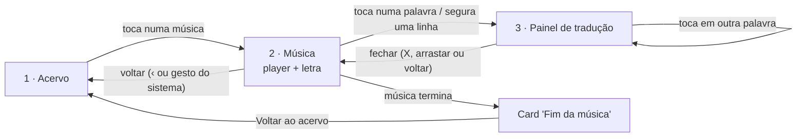

# Design das Telas — Lyrix (MVP)

Este documento explica o design de cada tela do MVP, com base em [`Funcionalidades-MVP.md`](Funcionalidades-MVP.md). As cores, fontes e medidas citadas estão no [Guia de Identidade Visual](Guia-de-Identidade-Visual.md).

**Como ver as telas:** abra [`telas/index.html`](telas/index.html) no navegador. Cada tela também pode ser aberta sozinha (arquivos `telas/NN-nome.html`), em tamanho real de celular (390 × 844 px). É preciso estar com internet para as fontes carregarem.

> As músicas, os artistas e a letra usados nas telas são fictícios, criados só para exemplo. A moldura tracejada no player também só existe na referência: no app, ali fica o player oficial do YouTube.

---

## Sumário

| # | Tela / estado | Arquivo |
|---|---|---|
| 1 | Acervo | [01-acervo.html](telas/01-acervo.html) |
| 1a | Acervo — carregando | [02-acervo-carregando.html](telas/02-acervo-carregando.html) |
| 1b | Acervo — vazio | [03-acervo-vazio.html](telas/03-acervo-vazio.html) |
| 1c | Acervo — erro | [04-acervo-erro.html](telas/04-acervo-erro.html) |
| 1d | Acervo — sem conexão | [05-acervo-sem-conexao.html](telas/05-acervo-sem-conexao.html) |
| 2 | Música — tocando | [06-musica-tocando.html](telas/06-musica-tocando.html) |
| 2a | Música — trecho instrumental | [07-musica-instrumental.html](telas/07-musica-instrumental.html) |
| 2b | Música — rolagem manual | [08-musica-rolagem-manual.html](telas/08-musica-rolagem-manual.html) |
| 2c | Música — carregando | [09-musica-carregando.html](telas/09-musica-carregando.html) |
| 2d | Música — anúncio do YouTube | [10-musica-anuncio.html](telas/10-musica-anuncio.html) |
| 2e | Música — vídeo indisponível | [11-musica-indisponivel.html](telas/11-musica-indisponivel.html) |
| 2f | Música — aberta sem conexão | [12-musica-sem-conexao.html](telas/12-musica-sem-conexao.html) |
| 2g | Música — conexão perdida | [13-musica-conexao-perdida.html](telas/13-musica-conexao-perdida.html) |
| 2h | Música — terminada | [14-musica-fim.html](telas/14-musica-fim.html) |
| 3 | Painel de tradução — palavra (F4) | [15-traducao-palavra.html](telas/15-traducao-palavra.html) |
| 3a | Painel de tradução — frase (F5) | [16-traducao-frase.html](telas/16-traducao-frase.html) |
| 3b | Painel de tradução — carregando | [17-traducao-carregando.html](telas/17-traducao-carregando.html) |
| 3c | Painel de tradução — erro | [18-traducao-erro.html](telas/18-traducao-erro.html) |
| — | Modo escuro (Acervo, Música, painéis) | [19](telas/19-acervo-escuro.html) · [20](telas/20-musica-escuro.html) · [21](telas/21-traducao-palavra-escuro.html) · [22](telas/22-traducao-frase-escuro.html) |

A tela 4 do documento de funcionalidades (**Configurações**) não foi desenhada, porque ainda está "a definir" e só existiria se o ajuste de atraso, a velocidade ou o login entrassem no MVP.

---

## Fluxo de navegação

- O usuário trabalha com **uma música por vez**. Para ouvir outra, volta ao Acervo.
- O painel de tradução é parte da tela de Música (não é uma nova rota). No Android, o botão voltar **fecha o painel primeiro**; só o segundo toque sai da música.
- Se o app vai para **segundo plano**, a música pausa (F2). Ao voltar, a tela está igual a como foi deixada; o usuário retoma pelo player.

---

## Estrutura comum

- **Fundo** `fundo`, margens laterais de 16–20 px e respeito às áreas seguras do sistema (topo e barra de gestos).
- **Sem barra de abas nem menu:** o MVP tem só duas telas, então a navegação é uma pilha simples (Acervo → Música).
- Componentes reutilizados em todas as telas: botões, card de música, faixa de aviso, estado de mensagem (vazio/erro), esqueleto de carregamento e painel de tradução. Todos estão descritos no guia.

---

## 1. Acervo (F1)

[01-acervo.html](telas/01-acervo.html) · escuro: [19-acervo-escuro.html](telas/19-acervo-escuro.html)

**Objetivo:** escolher uma música do acervo curado.

**Layout (de cima para baixo):**

1. Título **"Músicas"** (28/34, 800) e subtítulo "Escolha uma música para estudar".
2. Rótulo **"8 MÚSICAS · A–Z"**, que informa a quantidade e a ordem.
3. Lista de **cards de música**, com 8 px entre eles. Cada card tem:
   - miniatura 16:9 (96 × 54) do vídeo;
   - **título** (17/22, 600) e **artista** (15/20, texto secundário), com reticências se o texto for longo;
   - seta à direita, indicando que abre outra tela.

**Interações:**

- Tocar em qualquer ponto do card abre a tela de Música daquela faixa. Ao pressionar, o card fica com fundo `primaria-tinta`.
- A lista rola verticalmente. Pode ter "puxar para atualizar" (gesto nativo).

**Decisões sobre os itens "a definir":**

- **Busca / filtro:** não incluídos. Com um acervo curado e pequeno no começo, a lista basta.
- **Nível CEFR:** não aparece.
- **Ordenação:** alfabética por título (A–Z), indicada no rótulo acima da lista.
- **Capa / miniatura:** incluída, usando a miniatura do próprio YouTube (não exige trabalho extra de curadoria). Se for descartada, o card funciona sem ela (ver Componentes no guia).

### Estados do Acervo

| Estado | Arquivo | O que aparece |
|---|---|---|
| **Carregando** | [02](telas/02-acervo-carregando.html) | Título e subtítulo já visíveis; 7 cards "esqueleto" com o mesmo formato dos cards reais. |
| **Vazio** | [03](telas/03-acervo-vazio.html) | Selo com ícone de música, "Nenhuma música por aqui ainda", texto "O acervo está sendo preparado. Volte daqui a pouco." e botão secundário **Atualizar**. |
| **Erro** | [04](telas/04-acervo-erro.html) | Selo de alerta em vermelho, "Não foi possível carregar as músicas" e botão primário **Tentar de novo**. |
| **Sem conexão** | [05](telas/05-acervo-sem-conexao.html) | Selo com ícone de wi-fi cortado, "Você está sem conexão", "Conecte-se à internet para ver o acervo e ouvir as músicas." e **Tentar de novo**. |

---

## 2. Música (F2 + F3)

[06-musica-tocando.html](telas/06-musica-tocando.html) · escuro: [20-musica-escuro.html](telas/20-musica-escuro.html)

**Objetivo:** assistir ao vídeo e acompanhar a letra sincronizada, com acesso às traduções.

**Layout (de cima para baixo):**

1. **Barra superior (56 px):** botão voltar (44 × 44, "Voltar ao acervo") + título da música (17/22, 700) e artista (13/18).
2. **Player do YouTube:** largura total, 16:9 (390 × 219 numa tela de 390 px, acima do mínimo de 200 × 200). Usa os controles próprios do YouTube. **Nada fica sobreposto a ele** — avisos, painel e botões ficam sempre abaixo.
3. **Dica (40 px):** "Toque numa palavra ou segure uma linha para traduzir", em legenda discreta. É também a única instrução do app sobre os gestos.
4. **Área da letra:** ocupa todo o resto da tela.
   - Letra em **Atkinson Hyperlegible 20/30**, uma linha por verso, com 6 px entre linhas.
   - **Linha atual:** fundo âmbar (`destaque-tinta`), texto principal e negrito. São três sinais ao mesmo tempo (fundo, peso e cor), então funciona também para quem não distingue cores.
   - **Demais linhas:** texto secundário, peso normal.
   - Cada palavra é um botão com 44 px de altura (a altura da linha).

**Rolagem automática (decisão sobre item "a definir"):**

- A letra rola sozinha para manter a linha atual a cerca de **1/3 da altura** da área da letra, mostrando o contexto acima e as próximas linhas abaixo.
- Se o usuário **rolar manualmente**, a rolagem automática pausa e aparece o botão flutuante **"Voltar à linha atual"** ([08](telas/08-musica-rolagem-manual.html)). A seta aponta para baixo ou para cima, conforme onde está a linha atual.
- O acompanhamento volta sozinho após **~5 segundos sem tocar na tela**, ou na hora, ao tocar no botão.

**Destaque (decisão sobre item "a definir"):** granularidade **por linha**, sem karaokê por palavra. O fundo âmbar faz um fade curto ao trocar de linha, sem mudar o tamanho da linha (para não "pular" o texto).

### Estados da Música

| Estado | Arquivo | O que aparece |
|---|---|---|
| **Trecho instrumental** | [07](telas/07-musica-instrumental.html) | Nenhuma linha destacada. Antes da primeira linha (e em pausas longas) aparece um marcador discreto "♪ Instrumental", que não é tocável. |
| **Rolagem manual** | [08](telas/08-musica-rolagem-manual.html) | Linha atual fora da área visível e botão flutuante "Voltar à linha atual". |
| **Carregando** | [09](telas/09-musica-carregando.html) | Área do player em preto com indicador de carregamento e "Carregando vídeo…"; a letra aparece como esqueleto. A barra superior já mostra título e artista. |
| **Anúncio do YouTube** | [10](telas/10-musica-anuncio.html) | O anúncio toca no player (o app não o bloqueia). Abaixo do player, faixa informativa em índigo: "Anúncio em reprodução. A letra volta a acompanhar quando a música começar." A letra **fica parada e sem destaque**; continua legível e as traduções continuam funcionando. |
| **Vídeo indisponível** | [11](telas/11-musica-indisponivel.html) | Vídeo removido, bloqueado no país ou com incorporação desativada. O player não é carregado: no lugar dele, um bloco neutro com ícone de vídeo cortado. Abaixo: "Música indisponível no momento", "O vídeo foi removido ou não pode ser exibido no app. Escolha outra música do acervo." e botão **Voltar ao acervo**. |
| **Aberta sem conexão** | [12](telas/12-musica-sem-conexao.html) | Bloco neutro com ícone de wi-fi cortado no lugar do player. "Você está sem conexão", botão **Tentar de novo** e botão de texto **Voltar ao acervo**. |
| **Conexão perdida durante a música** | [13](telas/13-musica-conexao-perdida.html) | Faixa vermelha abaixo do player: "Sem conexão. A música pode parar e as traduções não funcionam até você se reconectar." A letra continua acompanhando o que já foi carregado. Quando a conexão volta, a faixa vira verde ("Conexão restabelecida.") por ~3 s e some. |
| **Música terminada** | [14](telas/14-musica-fim.html) | Nenhuma linha destacada; a letra rola até o fim e mostra o card **"Fim da música"** (selo verde de concluído), com "Para estudar outra, volte ao acervo e escolha uma nova música." e botão **Voltar ao acervo**. Não há próxima música automática. Para ouvir de novo, o usuário usa o próprio player do YouTube. |

---

## 3. Painel de tradução (F4 + F5)

[15-traducao-palavra.html](telas/15-traducao-palavra.html) · [16-traducao-frase.html](telas/16-traducao-frase.html) · escuro: [21](telas/21-traducao-palavra-escuro.html) · [22](telas/22-traducao-frase-escuro.html)

**Objetivo:** mostrar a tradução da palavra tocada ou da frase curta selecionada, **nunca da letra inteira**.

**Formato (decisão sobre item "a definir"):** um **único painel** para palavra e frase, que **sobe de baixo** (bottom sheet) e ocupa **só a área da letra** — nunca cobre o player nem a barra superior.

**Layout do painel:**

1. Alça de arrastar (36 × 4).
2. Rótulo **"PALAVRA"** ou **"FRASE"** (em verde-azulado) e botão fechar (X, 44 × 44).
3. A palavra (Atkinson 28/34, 700) ou a frase entre aspas (Atkinson 22/30, 700), em inglês.
4. Divisor.
5. A **tradução** em português (Atkinson 20/28, verde-azulado).

**Comportamento:**

- **Palavra (F4):** tocar numa palavra a destaca em índigo (`primaria-tinta`) e abre o painel. Tocar em outra palavra **troca o conteúdo** do painel, sem fechar e reabrir.
- **Frase (F5) — gesto (decisão sobre item "a definir"):** **segurar** (toque longo, ~450 ms) uma linha seleciona a linha inteira e abre o painel com a tradução. As **alças** no início e no fim permitem encurtar a seleção (por exemplo, só "running out of time"). A tradução atualiza ao soltar a alça.
- **Tamanho máximo da seleção:** até **2 linhas consecutivas** (frase curta). Não dá para selecionar mais que isso.
- **A música não pausa** ao abrir o painel (decisão sobre item "a definir"): o player continua visível e o usuário pausa pelos controles do YouTube quando quiser. A linha atual continua mudando, mas a **rolagem automática fica pausada** enquanto o painel estiver aberto, para a linha estudada não sair de vista.
- Ao abrir, a letra rola para que a linha da palavra/frase fique **acima do painel**.
- **Sem véu escuro** atrás do painel: a letra continua visível e tocável.
- **Fechar:** botão X, arrastar o painel para baixo ou botão voltar do Android. Ao fechar, a seleção some e a rolagem automática volta.
- **Conteúdo do painel (decisão):** só palavra/frase + tradução. Classe gramatical e exemplo não entram no MVP (ver sugestões).

### Estados do painel

| Estado | Arquivo | O que aparece |
|---|---|---|
| **Carregando** | [17](telas/17-traducao-carregando.html) | A palavra já aparece (é conhecida na hora); no lugar da tradução, um bloco esqueleto e "Traduzindo…". |
| **Erro** | [18](telas/18-traducao-erro.html) | Ícone de alerta, "Não foi possível traduzir agora." e botão compacto **Tentar de novo**. O painel continua aberto, sem perder a seleção. |

---

## 4. Modo escuro

[19](telas/19-acervo-escuro.html) · [20](telas/20-musica-escuro.html) · [21](telas/21-traducao-palavra-escuro.html) · [22](telas/22-traducao-frase-escuro.html)

Segue a configuração do sistema (não há opção dentro do app, já que não existe tela de configurações). Usa os mesmos componentes e layouts, só trocando os tokens de cor (ver guia). Pensado para estudar à noite: fundo `#111218` (não preto puro), linha atual em âmbar escuro com texto branco e traduções em verde-azulado claro.

---

## Pontos ambíguos do documento e decisões tomadas

| Ponto "a definir" | Decisão | Motivo |
|---|---|---|
| Busca/filtro no acervo | Não incluído | Acervo curado e pequeno; não está nas funcionalidades confirmadas. |
| Nível CEFR | Não aparece | Idem. Fica como sugestão. |
| Ordenação | A–Z por título | Previsível e fácil de achar uma música. |
| Capa/miniatura | Miniatura do YouTube | Custo zero e ajuda a reconhecer a música. |
| Comportamento da letra no anúncio | Parada, sem destaque + aviso abaixo do player | Evita destacar uma linha que não está tocando e explica o porquê. |
| Rolagem automática e rolagem manual | Auto a 1/3 da área; pausa ao rolar; botão "Voltar à linha atual"; retoma após ~5 s | Equilibra acompanhar a música e deixar o usuário reler. |
| Estilo do destaque | Fundo âmbar + negrito + cor do texto | Alta visibilidade, acessível, não muda o tamanho da linha. |
| Formato do painel | Bottom sheet só na área da letra | Requisito de não cobrir o player. |
| Classe gramatical e exemplo | Não incluídos | Mantém o MVP simples; fica como sugestão. |
| Pausar ao abrir a tradução | Não pausa | O player está sempre visível e acessível; pausar automaticamente interromperia quem quer só uma olhada rápida. |
| Gesto de seleção de frase | Toque longo na linha + alças para ajustar | Gesto conhecido de seleção de texto; não conflita com o toque simples (palavra). |
| Tamanho máximo da frase | Até 2 linhas | Mantém a "frase curta" e evita traduzir a letra inteira. |
| Mesmo painel para F4 e F5 | Sim | Menos componentes e comportamento consistente. |
| Texto de "música indisponível" | "Música indisponível no momento" + explicação + "Voltar ao acervo" | Diz o que aconteceu e o que fazer. |
| Fim da música | Card "Fim da música" com "Voltar ao acervo" | Não há fila; o próximo passo natural é escolher outra música. |
| Tela de Configurações | Não desenhada | Depende de itens ainda sem decisão. |

---

## Sugestões (fora do design atual)

Itens que **não foram incluídos** porque não estão no documento de funcionalidades, mas que valem avaliar:

1. **Ajuste de atraso da letra** para fones Bluetooth — prioridade alta, porque a letra adiantada em 100–300 ms atrapalha justamente o elemento principal do app.
2. **Nível CEFR** no card da música, para o usuário escolher músicas do seu nível.
3. **Classe gramatical** (e talvez um exemplo) no painel de tradução, útil em palavras ambíguas como "on" ou "running".
4. **Botão "Ouvir de novo"** no card de fim da música.
5. **Dica de uso só no primeiro acesso**, liberando os 40 px da dica fixa para a letra depois que o usuário já aprendeu os gestos.
6. **Área de toque ampliada** para palavras curtas ("a", "I"), direcionando o toque para a palavra mais próxima.
7. **Busca no acervo**, quando ele passar de algumas dezenas de músicas.
